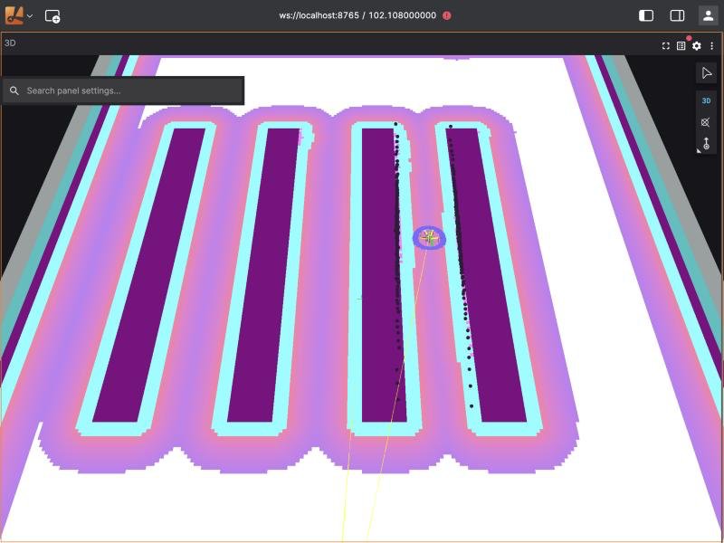

# warehouse-nav2

[](https://github.com/adricampos10/warehouse-nav2/actions/workflows/ci.yml)

I'm building an autonomous warehouse robot with **ROS 2 Jazzy + Nav2**, simulated in **Gazebo Harmonic** (and later NVIDIA Isaac Sim), with a **behavior-tree mission** and an **automated scenario test suite** that runs headless in Docker and on GitHub Actions.

> Work in progress.

## What I'm building
- Differential-drive robot navigating a warehouse with Nav2.
- Mission logic as a behavior tree: go to a shelf, wait, return, recover if blocked.
- Scenario suite (moving obstacles, narrow aisles, people crossing) run headless in Docker, reporting success rate, time to goal and minimum obstacle distance.
- CI with GitHub Actions running the scenarios on every change.

## Docs
- [Command cheatsheet](docs/cheatsheet.md) — the Docker, ROS 2 and Git commands I use, explained.
- [Diagrams](docs/diagrams/README.md) — how the project is put together.

## Run the environment
```bash
docker build -t warehouse-nav2:jazzy docker/
docker run --rm -it warehouse-nav2:jazzy bash
```

## My warehouse


A 14 × 10 m building with a loading area and four rows of shelves (6 × 0.6 m). The aisles between them are 1.2 m wide, except for one narrow aisle of 1.0 m: with the robot's 0.22 m radius and Nav2's 0.7 m obstacle inflation, that one is hard on purpose.

[`make_warehouse.py`](scripts/make_warehouse.py) holds the layout as a list of boxes and generates both the Gazebo world ([`worlds/warehouse.sdf.xacro`](worlds/warehouse.sdf.xacro)) and the Nav2 map ([`maps/warehouse.pgm`](maps/warehouse.pgm) + `.yaml`) from it, so the simulation and the map can never disagree. A unit test fails if the files in the repo are out of date:
```bash
python3 scripts/make_warehouse.py
```
I don't change Nav2 for this: `tb3_simulation_launch.py` already takes the world, the map and the spawn position as arguments. My launch file, [`launch/sim.launch.py`](launch/sim.launch.py), fills them in from a world name or a scenario file (using [`worlds.py`](scripts/worlds.py)) and, with `viz:=true`, also starts `foxglove_bridge`. Every script starts the simulation through it:
```bash
ros2 launch /ws/launch/sim.launch.py world_name:=warehouse viz:=true                 # to watch it
ros2 launch /ws/launch/sim.launch.py scenario:=/ws/scenarios/warehouse_shelf.yaml   # to test it
```

## Run the scenario suite
Each file in [`scenarios/`](scenarios) describes a navigation test: the world (Nav2's TurtleBot3 sandbox by default, or my warehouse), start pose, one or more goals, a time limit, and whether Nav2 should succeed or fail:
```yaml
description: Drive through the 1.0 m narrow aisle
world: warehouse
start: [-5.5, 0.0]
goals:
  - [-3.0, -1.1]
  - [1.0, -1.1]
  - [5.5, -1.1]
timeout: 180
```
```bash
scripts/run_scenarios.sh              # every scenario
scripts/run_scenarios.sh short_goal   # just one
```
Every scenario gets a fresh headless simulation in its own container. The image sets `ROS_AUTOMATIC_DISCOVERY_RANGE=LOCALHOST`, so ROS only discovers nodes inside each container, and a scenario can run while I watch another simulation in Lichtblick (before that, the two robots' topics got mixed up). [`run_scenario.py`](scripts/run_scenario.py) drives the robot through the goals while recording `/odom` and `/scan`, then saves `results/<scenario>.json`. A scenario passes if the robot reaches every goal in time without its edge getting closer than 0.05 m to an obstacle (the closest laser reading minus the robot's 0.22 m radius, the same radius Nav2 uses) (or, for `expect: failure`, if Nav2 gives up). The script ends with a summary table; this is a run on my Mac:

| Scenario | Result | Goals | Time (s) | Path (m) | Min clearance (m) | Notes |
|---|---|---|---|---|---|---|
| cross_map | PASS | 1/1 | 25.6 | 4.61 | 0.14 | all goals reached |
| patrol_loop | PASS | 4/4 | 50.7 | 11.52 | 0.10 | all goals reached |
| short_goal | PASS | 1/1 | 6.1 | 2.31 | 0.14 | all goals reached |
| unreachable_goal | PASS | 0/1 | 0.0 | 0.00 | 0.26 | failed as expected |
| warehouse_narrow_aisle | PASS | 3/3 | 27.9 | 11.30 | 0.19 | all goals reached |
| warehouse_patrol | PASS | 3/3 | 99.3 | 39.76 | 0.49 | all goals reached |
| warehouse_shelf | PASS | 1/1 | 18.2 | 7.11 | 0.27 | all goals reached |

The narrow aisle taught me something: my first version only had goals at both ends, and the robot passed with its laser never closer than 0.80 m to anything, which is impossible inside a 1.0 m aisle. The planner had gone around the shelves, because the inflated costmap makes the narrow aisle expensive. A goal in the middle of the aisle forces it through, and now the clearance (0.19 m from the robot's edge) proves it.

The pass/fail logic and the metrics live in [`metrics.py`](scripts/metrics.py), with no ROS imports, so they are unit-tested with pytest in milliseconds, together with the warehouse generator and a check that every warehouse scenario starts and ends in free space on the map:
```bash
docker run --rm -v "$PWD":/ws -w /ws warehouse-nav2:jazzy pytest -v
```

### In VS Code
`metrics.py` has no ROS dependencies, so I also run and debug its tests on my Mac, in a virtual environment:
```bash
python3 -m venv .venv
.venv/bin/pip install -r requirements-dev.txt
```
The settings in [`.vscode/`](.vscode) point VS Code at `.venv` and pytest, so the tests show up in the Testing panel, where I can run or debug each one with breakpoints.

### On GitHub Actions
On every pull request and every push to `main`, the [workflow](.github/workflows/ci.yml) runs the unit tests first, then one parallel job per scenario file (a build matrix, so adding a YAML file adds a job), and finally writes the results table to the run's summary page.

## Quick check
To check that everything starts and the robot can drive, I run the shortest scenario on its own (about a minute):
```bash
scripts/run_scenarios.sh short_goal
```

## Watch the robot
Docker on my Mac cannot open Gazebo's window, so I watch the simulation in [Lichtblick](https://github.com/lichtblick-suite/lichtblick) (the open-source Foxglove) through `foxglove_bridge`:
```bash
scripts/run_sim_viz.sh warehouse   # terminal 1: simulation + foxglove_bridge on ws://localhost:8765
                                   # (without an argument: Nav2's TurtleBot3 sandbox)
scripts/run_viewer.sh    # terminal 2: Lichtblick on http://localhost:8080
```
Then open <http://localhost:8080/?ds=foxglove-websocket&ds.url=ws://localhost:8765>. The layout in [`viz/lichtblick_layout.json`](viz/lichtblick_layout.json) shows the map, global costmap, laser scan, planned path and robot model. `run_sim_viz.sh` sets the initial pose automatically, so goals can be sent straight away with the 3D panel's *Publish pose* tool (it publishes on `/goal_pose`). To watch it drive around on its own, I run a scenario of the same world in that container:
```bash
docker exec nav2viz bash -c "source /opt/ros/jazzy/setup.bash && cd /ws/scripts && python3 run_scenario.py /ws/scenarios/warehouse_patrol.yaml /tmp/results"
```
