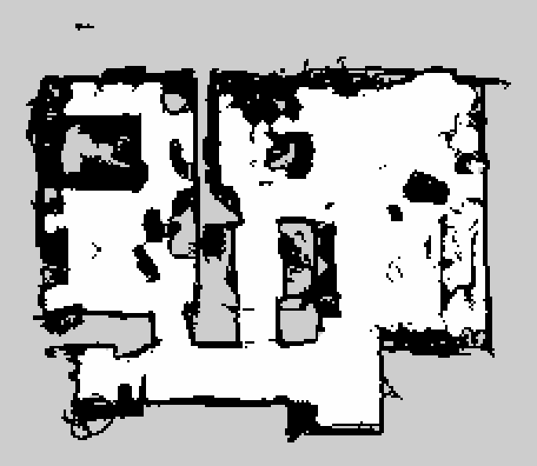
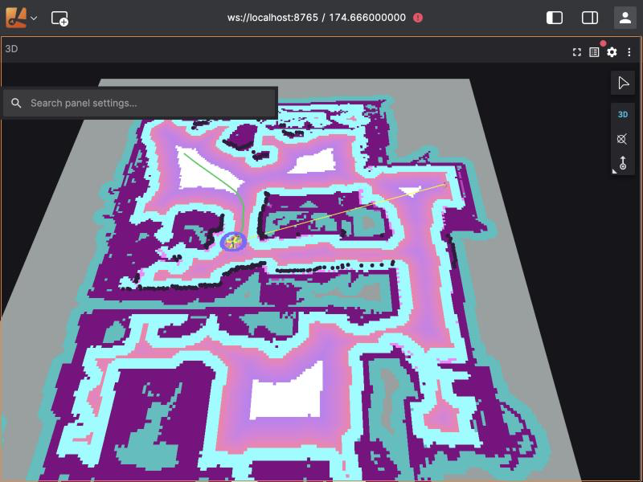

# warehouse-nav2

[](https://github.com/adricampos10/warehouse-nav2/actions/workflows/ci.yml)

I'm building an autonomous warehouse robot with **ROS 2 Jazzy + Nav2**, simulated in **Gazebo Harmonic** (and later NVIDIA Isaac Sim), with a **behavior-tree mission** and an **automated scenario test suite** that runs headless in Docker and on GitHub Actions.

> Work in progress.

## What I'm building
- Differential-drive robot navigating a warehouse with Nav2.
- Mission logic as a behavior tree: go to a shelf, wait, return, recover if blocked.
- Scenario suite (moving obstacles, narrow aisles, people crossing) run headless in Docker, reporting success rate, time to goal and minimum obstacle distance.
- CI with GitHub Actions running the scenarios on every change.

## Docs
- [Command cheatsheet](docs/cheatsheet.md) — the Docker, ROS 2 and Git commands I use, explained.
- [Diagrams](docs/diagrams/README.md) — how the project is put together.

## Run the environment
```bash
docker build -t warehouse-nav2:jazzy docker/
docker run --rm -it warehouse-nav2:jazzy bash
```

## My warehouse


A 14 × 10 m building with a loading area and four rows of shelves (6 × 0.6 m). The aisles between them are 1.2 m wide, except for one narrow aisle of 1.0 m: with the robot's 0.22 m radius and Nav2's 0.7 m obstacle inflation, that one is hard on purpose.

[`make_warehouse.py`](scripts/make_warehouse.py) holds the layout as a list of boxes and generates both the Gazebo world ([`worlds/warehouse.sdf.xacro`](worlds/warehouse.sdf.xacro)) and the Nav2 map ([`maps/warehouse.pgm`](maps/warehouse.pgm) + `.yaml`) from it, so the simulation and the map can never disagree. A unit test fails if the files in the repo are out of date:
```bash
python3 scripts/make_warehouse.py
```
I don't change Nav2 for this: `tb3_simulation_launch.py` already takes the world, the map and the spawn position as arguments. My launch file, [`launch/sim.launch.py`](launch/sim.launch.py), fills them in from a world name or a scenario file (using [`worlds.py`](scripts/worlds.py)) and, with `viz:=true`, also starts `foxglove_bridge`. Every script starts the simulation through it:
```bash
ros2 launch /ws/launch/sim.launch.py world_name:=warehouse viz:=true                 # to watch it
ros2 launch /ws/launch/sim.launch.py scenario:=/ws/scenarios/warehouse_shelf.yaml   # to test it
```

## My home, scanned with my iPhone


The same map as the robot uses it, in Lichtblick: Nav2's costmap paints the inflation around every wall, the black dots are the laser hits, and the green line is the path Nav2 planned to the living room.



I scanned my home (about 11 × 10 m) with the RTAB-Map iOS app on my iPhone 16 Pro Max, which uses its LiDAR and ARKit, and saved the scan with "Optimize" so the poses are corrected by its loop closures. [`scan_to_map.py`](scripts/scan_to_map.py) turns that database into a Nav2 map ([`maps/house.pgm`](maps/house.pgm) + `.yaml`) without installing RTAB-Map:

- it back-projects every LiDAR depth image into 3D points with the frame's optimized pose;
- it finds the floor, and marks points 0.10–1.5 m above it as obstacles;
- it turns the map so the walls line up with the axes, with (0, 0) where I started;
- a cell is occupied if it has enough obstacle points and the camera didn't see through it; free space is where the floor was seen or the camera saw through, connected to the path I walked (so what was seen through windows and mirrors is dropped);
- `--fill x,y` turns an enclosed unknown area into free space, for a part of a room I didn't scan;
- walls lose one layer of cells on the free side, because the scan makes them fatter than they are (never thinner than two cells, so no hole opens).

```bash
docker run --rm -v "$PWD":/ws warehouse-nav2:jazzy \
    python3 /ws/scripts/scan_to_map.py /ws/house1.db /ws/maps/house \
    --fill=0.68,5.63 --fill=-0.08,5.88 --fill=1.58,5.58
```
After that, I removed a few specks of scan noise from `maps/house.pgm` by hand (small blobs and dashes in open floor), so the map in the repo is that edited version. The scan itself stays out of the repo, because it holds photos of my home; the map has no images.

### Driving through it in Gazebo
The scan has no list of walls like my warehouse, so [`map_to_world.py`](scripts/map_to_world.py) builds the Gazebo world from the map itself: it covers the occupied cells with as few boxes as it can (about 1,000) and makes them 1 m high, so the robot's laser sees in Gazebo exactly what Nav2 has in its map. A unit test fails if the world is out of date with the map:
```bash
python3 scripts/map_to_world.py maps/house.yaml worlds/house.sdf.xacro
```
`house` is a third world in [`worlds.py`](scripts/worlds.py), with two scenarios: to the living room, and a tour of the home and back. I also had one through the doorway into the room on the left, but in my map it leaves the robot about 1 cm: it passed five times out of five on my Mac and then touched the frame on GitHub Actions, so I removed it rather than keep a flaky test.

Two things broke on the way, both worth knowing:
- **Gazebo sometimes didn't start.** Nav2's launch file runs xacro (which writes the world to a temporary file) and Gazebo at the same time. With 1,000 boxes inline, xacro was sometimes still writing when Gazebo opened the file. The walls now live in their own SDF file ([`worlds/house_walls.sdf`](worlds/house_walls.sdf)) that the world includes, so the world is as small as my warehouse.
- **AMCL got lost in narrow spots.** The robot drove off course and got stuck, although its wheel odometry was within 5 cm of Gazebo's true pose. AMCL's estimate had slid up to 3 m into the walls. Its default laser model (likelihood field) only checks how far each laser point is from the nearest occupied cell, and my scanned walls are 25–50 cm thick: a point that lands inside a thick wall scores as well as one on its surface, so moving into a wall costs nothing. I found it by comparing AMCL with Gazebo's true pose while the robot spun in place (30 cm off in 15 s at the entrance, 5 cm in the open living room and in my warehouse). The beam model follows each ray to the first wall, so for this world [`sim.launch.py`](launch/sim.launch.py) starts Nav2 with `laser_model_type: beam` (`PARAM_REWRITES` in `worlds.py`); AMCL then stays within 10 cm.

My home's passages are 60–80 cm wide and the robot is 44 cm. Nav2 cuts the corner into the right-hand corridor, and how close it passes the wall changes from run to run (1–6 cm in my runs). I first allowed 2 cm, and the tour failed on GitHub Actions at 1.8 cm. With any margin the test would be flaky, so the house scenarios only fail on contact (`min_clearance: 0.0`).

## Run the scenario suite
Each file in [`scenarios/`](scenarios) describes a navigation test: the world (Nav2's TurtleBot3 sandbox by default, my warehouse or my home), start pose, one or more goals, a time limit in simulated seconds (read from Gazebo's `/clock`, so a slow machine or a busy CI runner doesn't make a scenario time out), and whether Nav2 should succeed or fail:
```yaml
description: Drive through the 1.0 m narrow aisle
world: warehouse
start: [-5.5, 0.0]
goals:
  - [-3.0, -1.1]
  - [1.0, -1.1]
  - [5.5, -1.1]
timeout: 180
```
```bash
scripts/run_scenarios.sh              # every scenario
scripts/run_scenarios.sh short_goal   # just one
```
Every scenario gets a fresh headless simulation in its own container. The image sets `ROS_AUTOMATIC_DISCOVERY_RANGE=LOCALHOST`, so ROS only discovers nodes inside each container, and a scenario can run while I watch another simulation in Lichtblick (before that, the two robots' topics got mixed up). [`run_scenario.py`](scripts/run_scenario.py) drives the robot through the goals while recording `/odom` and `/scan`, then saves `results/<scenario>.json`. A scenario passes if the robot reaches every goal in time without its edge getting closer than 0.05 m to an obstacle. The robot is a 0.22 m circle around `base_link` (the same `robot_radius` Nav2 uses), and the laser is mounted 6.4 cm behind its centre, so each scan is first moved into the robot's frame with TF and `laser_geometry`. If no laser data arrives, the clearance can't be checked and the scenario fails. For `expect: failure`, it passes if Nav2 gives up. The script ends with a summary table; this is a run on my Mac:

| Scenario | Result | Goals | Sim time (s) | Path (m) | Min clearance (m) | People gap (m) | Notes |
|---|---|---|---|---|---|---|---|
| cross_map | PASS | 1/1 | 14.7 | 4.54 | 0.15 | - | all goals reached |
| house_living_room | PASS | 1/1 | 20.1 | 6.76 | 0.04 | - | all goals reached |
| house_tour | PASS | 4/4 | 72.5 | 20.44 | 0.04 | - | all goals reached |
| patrol_loop | PASS | 4/4 | 49.9 | 11.62 | 0.12 | - | all goals reached |
| short_goal | PASS | 1/1 | 6.1 | 2.31 | 0.14 | - | all goals reached |
| unreachable_goal | PASS | 0/1 | 0.0 | 0.00 | 0.30 | - | failed as expected |
| warehouse_narrow_aisle | PASS | 3/3 | 27.5 | 11.24 | 0.21 | - | all goals reached |
| warehouse_patrol | PASS | 3/3 | 98.7 | 39.67 | 0.47 | - | all goals reached |
| warehouse_people | PASS | 1/1 | 38.4 | 15.24 | 0.47 | 0.49 | all goals reached |
| warehouse_person_head_on | PASS | 1/1 | 10.8 | 3.67 | 0.28 | 0.30 | all goals reached |
| warehouse_shelf | PASS | 1/1 | 18.1 | 7.24 | 0.20 | - | all goals reached |

The narrow aisle taught me something: my first version only had goals at both ends, and the robot passed with its laser never closer than 0.80 m to anything, which is impossible inside a 1.0 m aisle. The planner had gone around the shelves, because the inflated costmap makes the narrow aisle expensive. A goal in the middle of the aisle forces it through, and now the clearance (0.21 m from the robot's edge) proves it.

### Moving obstacles
A scenario can also have people walking around. Each one is a person-sized cylinder that walks back and forth along a path, at a given speed:
```yaml
obstacles:
  - path: [[-3.5, -2.5], [-3.5, 3.5]]   # across the loading area
    speed: 0.5                           # m/s
```
They are not on the map, so Nav2 only knows about them from the laser, like real people. [`move_obstacles.py`](scripts/move_obstacles.py), which my launch file starts when the scenario has obstacles, talks to Gazebo directly through gz-transport: it creates the cylinders, reads their poses and drives them with Gazebo's `VelocityControl` system (gravity is off for them, so they glide at exactly their speed and never tip over). They wait until the robot starts moving, so they meet it at the same point in every run, however long Nav2 takes to start, and they stop while the robot is right in front of them (closer than 0.5 m), like real people would. The walking logic is in [`obstacles.py`](scripts/obstacles.py), with no ROS or Gazebo imports, so it is unit-tested too.

In `warehouse_people`, two people cross the robot's way while it drives through the warehouse, and in `warehouse_person_head_on` a person walks straight at it; they ask for at least 0.20 m and 0.15 m of clearance, instead of 0.05 m. With people, the judge also checks for real contact: the script reads the robot's and the people's exact positions from Gazebo (not from the laser), stores the closest gap in the result as `obstacle_gap` (the *People gap* column) and fails the scenario if it goes below zero.

My first people were blind: they kept walking whatever happened, and Gazebo's `VelocityControl` pushes with unlimited force. While I was sending goals by hand in Lichtblick, a person walked into the robot and shoved it; the wheels didn't notice, AMCL corrected the robot's position with a jump, and the map appeared shifted. The head-on scenario reproduced it ("hit a moving obstacle: 0.03 m of overlap") before I made people stop for the robot, and passes since.

Moving obstacles only work in my warehouse: Gazebo publishes model poses only when the world loads its scene broadcaster, which Nav2's sandbox does only with the GUI, while my generated world always does.

The pass/fail logic and the metrics live in [`metrics.py`](scripts/metrics.py), with no ROS imports, so they are unit-tested with pytest in milliseconds, together with the warehouse generator and a check that every warehouse scenario starts and ends in free space on the map, and that its people only walk through free space:
```bash
docker run --rm -v "$PWD":/ws -w /ws warehouse-nav2:jazzy pytest -v
```

### In VS Code
`metrics.py` has no ROS dependencies, so I also run and debug its tests on my Mac, in a virtual environment:
```bash
python3 -m venv .venv
.venv/bin/pip install -r requirements-dev.txt
```
The settings in [`.vscode/`](.vscode) point VS Code at `.venv` and pytest, so the tests show up in the Testing panel, where I can run or debug each one with breakpoints.

### On GitHub Actions
On every pull request and every push to `main`, the [workflow](.github/workflows/ci.yml) runs the unit tests first, then one parallel job per scenario file (a build matrix, so adding a YAML file adds a job), and finally writes the results table to the run's summary page. A pull request that only changes documentation (`README.md` or `docs/`) skips the tests and the scenarios: a first job lists the changed files, and the final `report` job, which `main` requires, still runs and passes. A workflow-level `paths-ignore` would never start for those pull requests, so the required check would never come and the merge would wait forever.

## Quick check
To check that everything starts and the robot can drive, I run the shortest scenario on its own (about a minute):
```bash
scripts/run_scenarios.sh short_goal
```

## Watch the robot
Docker on my Mac cannot open Gazebo's window, so I watch the simulation in [Lichtblick](https://github.com/lichtblick-suite/lichtblick) (the open-source Foxglove) through `foxglove_bridge`:
```bash
scripts/run_sim_viz.sh warehouse   # terminal 1: simulation + foxglove_bridge on ws://localhost:8765
                                   # (without an argument: Nav2's TurtleBot3 sandbox;
                                   #  with a scenario name, e.g. warehouse_people: its people too)
scripts/run_viewer.sh    # terminal 2: Lichtblick on http://localhost:8080
```
Then open <http://localhost:8080/?ds=foxglove-websocket&ds.url=ws://localhost:8765>. The layout in [`viz/lichtblick_layout.json`](viz/lichtblick_layout.json) shows the map, global costmap, laser scan, planned path and robot model. `run_sim_viz.sh` sets the initial pose automatically, so goals can be sent straight away with the 3D panel's *Publish pose* tool (it publishes on `/goal_pose`). With a scenario such as `warehouse_people`, its people show up as moving circles in the laser scan and the costmap, and start walking when the robot does. To watch it drive around on its own, I run a scenario of the same world in that container:
```bash
docker exec nav2viz bash -c "source /opt/ros/jazzy/setup.bash && cd /ws/scripts && python3 run_scenario.py /ws/scenarios/warehouse_patrol.yaml /tmp/results"
```
