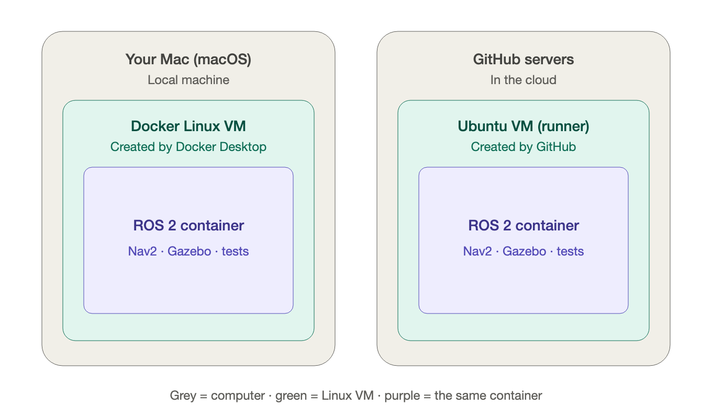
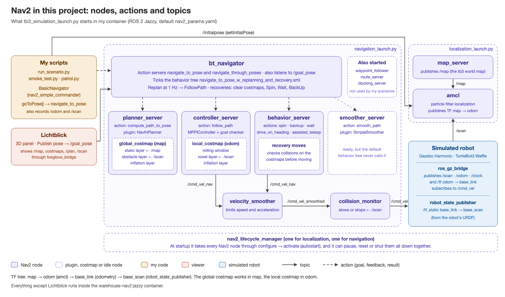

# Project diagrams

Visual resources I use to explain how this project is put together. Each diagram comes as an `.svg` (editable, sharp at any size) and a `.png` (for quick viewing or slides).

## 01 · Docker on my Mac and on GitHub

- **Grey — the physical computer.** My Mac, or GitHub's servers in the cloud.
- **Green — the Linux virtual machine.** There is one on each side and they are independent: on my Mac it is created by Docker Desktop (macOS is not Linux); on GitHub it is created by GitHub (the Actions *runner* is already an Ubuntu VM).
- **Purple — the container.** It is exactly the same on both sides (`warehouse-nav2:jazzy`, with ROS 2, Nav2, Gazebo and my test suite). That is why whatever runs on my Mac runs the same way in GitHub Actions.

## 02 · Nav2 in this project

The map I use to read Nav2's code, in the spirit of the classic `move_base` diagram. It shows what `tb3_simulation_launch.py` starts with the default `nav2_params.yaml`:

- **Goals come in as actions.** My scripts use `BasicNavigator.goToPose()`, which sends a `navigate_to_pose` action goal to **`bt_navigator`**. Lichtblick's *Publish pose* tool sends the same thing as a plain `/goal_pose` topic.
- **The behavior tree is the brain.** `bt_navigator` does not plan or drive by itself: it ticks a behavior tree that calls the other servers through actions. It replans with `planner_server` once per second, follows the path with `controller_server`, and on failure runs recoveries in turn: clear the costmaps, spin, wait, back up.
- **Each server loads plugins.** The planner is NavFn on the **global costmap** (frame `map`: static map + laser obstacles + inflation). The controller is MPPI on the **local costmap**, a small rolling window in frame `odom`.
- **The velocity command goes through two safety filters.** `/cmd_vel_nav` → `velocity_smoother` (speed and acceleration limits) → `collision_monitor` (slows or stops near obstacles) → `/cmd_vel` → the robot in Gazebo.
- **Localization is separate.** `map_server` publishes the map; `amcl` matches `/scan` against it and publishes the `map → odom` transform.
- **Lifecycle.** Every Nav2 node is a lifecycle node; `nav2_lifecycle_manager` configures and activates them in order at startup.
