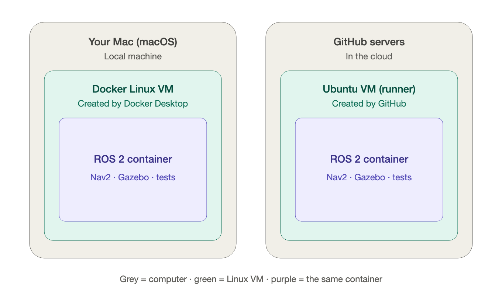
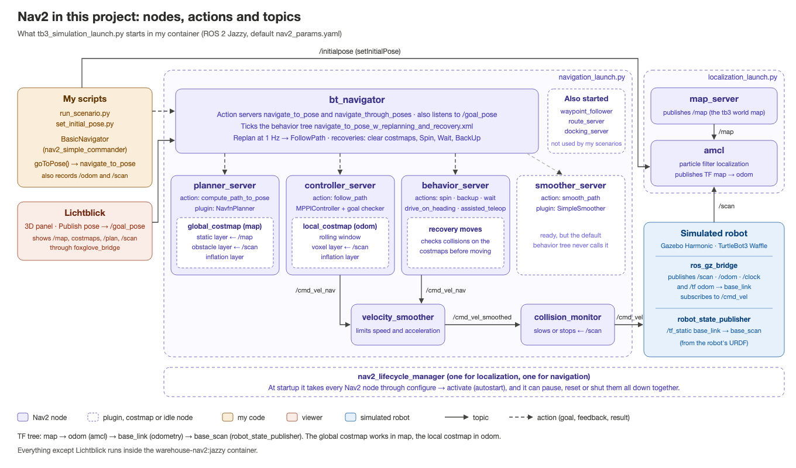
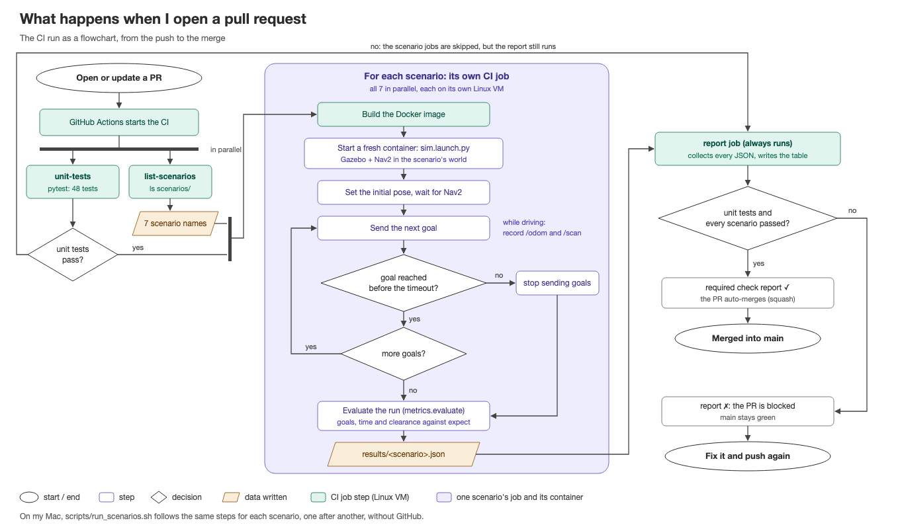
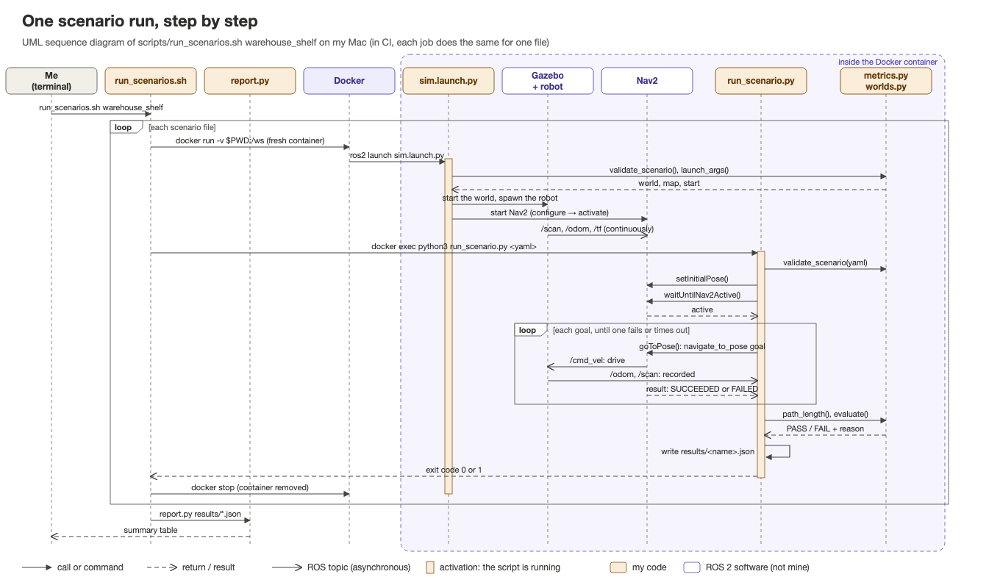
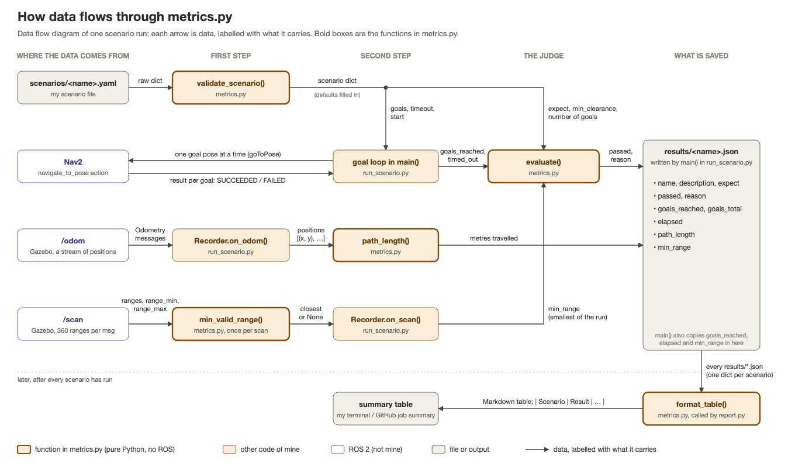

# Project diagrams

Visual resources I use to explain how this project is put together. Each diagram comes as an `.svg` (editable, sharp at any size) and a `.png` (for quick viewing or slides).

## 01 · Docker on my Mac and on GitHub

- **Grey — the physical computer.** My Mac, or GitHub's servers in the cloud.
- **Green — the Linux virtual machine.** There is one on each side and they are independent: on my Mac it is created by Docker Desktop (macOS is not Linux); on GitHub it is created by GitHub (the Actions *runner* is already an Ubuntu VM).
- **Purple — the container.** It is exactly the same on both sides (`warehouse-nav2:jazzy`, with ROS 2, Nav2, Gazebo and my test suite). That is why whatever runs on my Mac runs the same way in GitHub Actions.

## 02 · Nav2 in this project

The map I use to read Nav2's code, in the spirit of the classic `move_base` diagram. It shows what `tb3_simulation_launch.py` starts with the default `nav2_params.yaml`:

- **Goals come in as actions.** My scripts use `BasicNavigator.goToPose()`, which sends a `navigate_to_pose` action goal to **`bt_navigator`**. Lichtblick's *Publish pose* tool sends the same thing as a plain `/goal_pose` topic.
- **The behavior tree is the brain.** `bt_navigator` does not plan or drive by itself: it ticks a behavior tree that calls the other servers through actions. It replans with `planner_server` once per second, follows the path with `controller_server`, and on failure runs recoveries in turn: clear the costmaps, spin, wait, back up.
- **Each server loads plugins.** The planner is NavFn on the **global costmap** (frame `map`: static map + laser obstacles + inflation). The controller is MPPI on the **local costmap**, a small rolling window in frame `odom`.
- **The velocity command goes through two safety filters.** `/cmd_vel_nav` → `velocity_smoother` (speed and acceleration limits) → `collision_monitor` (slows or stops near obstacles) → `/cmd_vel` → the robot in Gazebo.
- **Localization is separate.** `map_server` publishes the map; `amcl` matches `/scan` against it and publishes the `map → odom` transform.
- **Lifecycle.** Every Nav2 node is a lifecycle node; `nav2_lifecycle_manager` configures and activates them in order at startup.

## 03 · What happens when I open a pull request

The CI run as a flowchart, from the push to the merge. Ovals are the start and the two possible ends, rectangles are steps, diamonds are decisions and parallelograms are data written along the way.

- **Two jobs start in parallel** (the black bar): `unit-tests` runs pytest, and `list-scenarios` lists the files in `scenarios/`.
- **Each scenario gets its own job** (purple), all of them in parallel: build the Docker image, start a fresh container with my launch file, set the initial pose, then send the goals one by one. The loop on the left is the `for` loop in `run_scenario.py`: if a goal isn't reached before the timeout, it stops sending goals. `metrics.evaluate()` then compares the run with what the scenario expects and writes `results/<scenario>.json`.
- **If the unit tests fail**, the scenario jobs are skipped, but the `report` job still runs (it has `if: always()`), so the PR still gets a clear red result.
- **The report decides**: it collects every JSON and writes the table. If the unit tests and every scenario passed, the required check is green and the PR auto-merges into `main`; otherwise the PR is blocked and `main` stays green until I fix it and push again.

On my Mac, `scripts/run_scenarios.sh` follows the same steps for each scenario, one after another.

## 04 · One scenario run, step by step

A UML sequence diagram of `scripts/run_scenarios.sh warehouse_shelf` on my Mac. Each box at the top is a participant and its dashed line is its lifeline; time runs downwards, and everything inside the dashed purple area runs inside the Docker container.

- **Setting up**: `run_scenarios.sh` starts a fresh container, whose main process is my launch file. It asks `metrics.py`/`worlds.py` for the scenario's world, map and start, then starts Gazebo with the robot and Nav2.
- **Driving**: `run_scenarios.sh` runs `run_scenario.py` inside the same container (`docker exec`). It sets the initial pose, waits for Nav2, and then sends the goals one by one (the inner `loop`): each is a `navigate_to_pose` action, and while Nav2 drives the robot through `/cmd_vel`, the script records `/odom` and `/scan`.
- **Deciding**: `metrics.py` turns the recording into PASS or FAIL, the script writes `results/<name>.json` and exits with 0 or 1, and the container is stopped. After every scenario (the outer `loop`), `report.py` prints the summary table.

Arrow styles follow UML: filled arrowheads are calls or commands, dashed arrows are replies, and open arrowheads on solid lines are asynchronous ROS topics. The narrow bars show when `sim.launch.py` and `run_scenario.py` are running. In CI, each scenario job runs one iteration of the outer loop.

## 05 · How data flows through metrics.py

A data flow diagram of one scenario run. Unlike diagram 04, it ignores time and who calls whom: each arrow is a piece of data, labelled with what it carries, and the bold boxes are the functions in `metrics.py`, which is plain Python with no ROS, so all of it is unit-tested.

- **The scenario**: `validate_scenario()` checks the YAML and fills in the defaults. The goals, timeout and start go to the goal loop in `run_scenario.py`; what the scenario expects and the minimum clearance go to the judge.
- **Nav2**: the goal loop sends one goal at a time and gets a result for each, which gives `goals_reached` and `timed_out`.
- **`/odom`**: every message becomes an `(x, y)` position, and `path_length()` turns the list into metres travelled. That number only goes into the JSON; it does not decide anything.
- **`/scan`**: `min_valid_range()` turns each laser scan into its closest valid reading, and `Recorder.on_scan()` keeps the smallest one of the run as `min_range`.
- **The judge**: `evaluate()` combines those three inputs into `passed` and `reason`, and `main()` writes everything to `results/<name>.json`. After every scenario has run, `format_table()` turns all the JSON files into the summary table.
